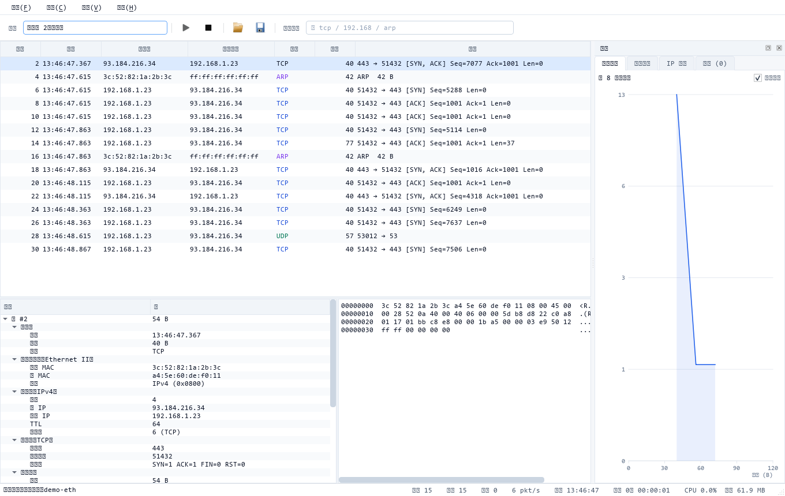

# NetScope 网络流量分析系统

个人电脑上的报文抓取与流量分析工具（计算机网络课程设计）。界面仿 Wireshark：报文列表、三层字段详情、十六进制、统计图表与告警面板。



## 功能（对照课设需求 2.2）

- **简洁的 GUI**：菜单栏、工具栏、网卡下拉、显示过滤、状态栏（PySide6）
- **三层逐字段解析**（见 [docs/解析清单.md](docs/解析清单.md)）：
  - 链路层：源/目的 MAC、以太网类型、VLAN/QinQ
  - 网络层：IPv4/IPv6 源/目的 IP、IP 版本、TTL/跳数限制、协议号；IPv4 选项、分片、IPv6 扩展头
  - 传输层：TCP/UDP 源/目的端口、TCP 标志位（SYN/ACK/FIN/RST）、ICMP 类型/代码
- **统计图表**：
  - 长度分布折线图（8 字节分箱，可切对数轴）
  - 长度三段柱状图（≤46 / 47–1500 / >1500 字节）
  - IP 版本柱状图（IPv4 / IPv6 / 其它）
- **数据持久化**：抓包时原始报文自动滚动落盘为 pcap（默认 文档/NetScope/capture-时间戳/，
  64 MB 一段）；"文件 → 另存为" 合并保存，"文件 → 打开" 回放 pcap/pcapng
- **1 天以上运行**：状态栏实时显示开始时间与运行时长（X天 HH:MM:SS）；
  每秒采样本进程 CPU/内存，每 5 秒写入捕获目录的 `资源占用.csv`；
  列表（5000 行）、告警（500 行）、统计均有界，数据落盘，内存不随运行增长
- **异常检测告警（扩展）**：SYN 泛洪、ICMP 回声请求泛洪、无请求应答异常、大包/分片回声；
  同规则同目标 60 秒冷却，阈值可在 `netscope/config.py` 的 `AlertConfig` 调整

## 目录结构

```
.
├─ src/
│  ├─ main.py                 # 入口（默认真实抓包，--demo / --list）
│  ├─ smoke_test.py           # 界面冒烟测试（可截图）
│  ├─ README.md               # 界面与后端接入说明
│  └─ netscope/
│     ├─ config.py            # CaptureConfig / AlertConfig（检测阈值）
│     ├─ core/
│     │  ├─ diagnostics.py    # Scapy / Npcap / 管理员自检
│     │  ├─ errors.py
│     │  ├─ models.py         # CaptureState / DeviceInfo / Frame / CaptureStats
│     │  ├─ capture.py        # CaptureEngine + ScapyBackend
│     │  ├─ parser.py         # 链路/网络/传输层解析
│     │  ├─ stats.py          # 长度直方图、三段、IP 版本统计
│     │  ├─ alerts.py         # SYN 泛洪 / ICMP 异常检测
│     │  └─ pcapio.py         # pcap 读写、滚动落盘
│     └─ ui/
│        ├─ live_controller.py# 采集引擎 → 解析/统计/告警/落盘 → Qt 信号
│        ├─ packet_rows.py    # ParsedFrame → PacketRow（三层字段）
│        ├─ controller.py     # 后端接口
│        ├─ models.py         # PacketRow、表格模型、过滤器
│        ├─ widgets.py        # 详情树、十六进制、告警表
│        ├─ charts.py         # 折线图、柱状图
│        ├─ demo.py           # 演示数据源（含异常流量演示）
│        ├─ main_window.py    # 主窗口（含资源占用监控）
│        └─ style.py          # 浅色主题
├─ tests/                     # unittest，不需要 Npcap
├─ docs/
│  ├─ ui-preview.png
│  └─ 解析清单.md              # 解析范围、边界、验收用例
├─ verify_e2e.py              # 端到端验证（告警/另存/回放，offscreen）
├─ requirements.txt
└─ .gitignore
```

## 运行

需要 Windows 10/11、Python 3.11+、Npcap；抓包要用**管理员**终端。

```powershell
python -m pip install -r requirements.txt

python src/main.py --list     # 只列网卡（不需要管理员）
python src/main.py            # 真实抓包（需要 Npcap + 管理员）
python src/main.py --demo     # 演示数据，只看界面（每 30 秒演示一种异常流量）
```

国内镜像：

```powershell
python -m pip install -r requirements.txt -i http://mirrors.aliyun.com/pypi/simple/ --trusted-host mirrors.aliyun.com
```

Npcap 下载：<https://npcap.com/#download>。安装时取消 “Restrict Npcap driver's access to Administrators only”，装完重启。

## 测试

```powershell
python -m unittest discover -s tests -t . -v
python src/smoke_test.py            # 界面冒烟（offscreen）
python src/smoke_test.py --shot ui.png
python verify_e2e.py                # 端到端：告警触发 + 另存 + 回放
```

覆盖：引擎状态机、队列丢弃、环境自检、三层解析（以太网/VLAN/QinQ/IPv4 选项/分片/
IPv6 扩展头/截断）、统计口径、告警规则与冷却、pcap 读写端序与滚动落盘、
LiveController 桥接、文件另存/回放。

## 采集与数据流

```
Npcap → AsyncSniffer 回调 → Frame → 有界队列 → QTimer(100ms)
      → parser.parse_frame → stats.add / alerts.ingest / pcap 滚动落盘
      → packet_rows.build_packet_row → 列表/详情/十六进制/图表
```

- 抓包回调只做 `bytes(pkt)` → `Frame` → 入队，解析和界面在别的线程/定时器里；
- 队列默认 20000 条，满则丢新包并计入 `dropped`，不反压驱动；
- 状态机 `IDLE → STARTING → RUNNING → STOPPING → IDLE`，失败进 `ERROR`；
- 启动前检查 Scapy、`wpcap.dll`、管理员权限，缺什么直接给可操作提示；
- 设备按"有 IPv4、物理网卡、metric 小"排序，默认选中第一块；
- 资源占用记录：状态栏每秒刷新 CPU/内存，抓包期间每 5 秒追加一行到捕获目录的
  `资源占用.csv`（时间 / 运行时长 / 包数 / CPU% / 内存 MB），供实验报告分析。

## 1 天运行实验说明

课设要求"安装在组员电脑上开启 1 天以上，观察并记录系统消耗资源"：

1. 组员电脑装好 Npcap + Python 依赖，管理员运行 `python src/main.py`，F5 开始抓包；
2. 状态栏持续显示"开始 HH:MM:SS / 运行 X天 HH:MM:SS / CPU x% 内存 x MB"；
3. 实验结束后"文件 → 打开捕获目录"，收集 pcap 段文件与 `资源占用.csv` 做分析；
4. 抓包线程独立于界面，正常上网办公不受影响；停止后可用"文件 → 另存为"
   把一天的数据合并成一个 pcap，再用"文件 → 打开"回放核对。

## 说明

- 列表"长度"列按 **IP 分组长度**主口径（IPv4 总长度 / IPv6 40+载荷长度 / 非 IP 帧长）；
- 演示数据（`src/netscope/ui/demo.py`）为伪造但结构合法的报文，走与真实抓包相同的
  解析/统计/告警链路，状态栏会显示"演示数据"标记；
- 没有 Npcap 时 `--list` 仍可用（Scapy 通过系统接口枚举），但启动抓包会给出提示。
