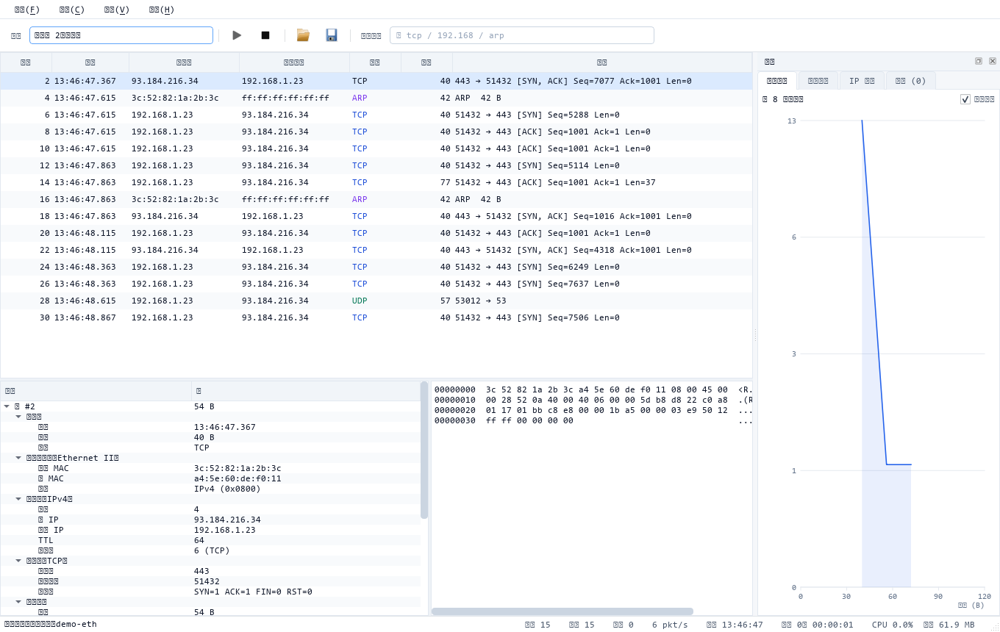

# NetScope 界面 + 采集链路 + 解析/统计/告警/持久化

仿 Wireshark 的主界面：工具栏 + 报文列表 + 三层字段详情 + 十六进制 + 右侧统计面板。
采集由 `core/capture.py` 完成，解析/统计/告警/落盘由 `core/` 其余模块完成，
`ui/live_controller.py` 把它们接成 Qt 信号。



## 运行

```powershell
python -m pip install -r requirements.txt
python src/main.py --list     # 只列网卡，不需要管理员
python src/main.py            # 真实抓包（Npcap + 管理员）
python src/main.py --demo     # 演示数据，只看界面
```

当前机器若没装 PySide6，`main.py` 会提示安装命令后退出，不会抛一堆 traceback。

## 界面内容

| 区域 | 内容 |
|---|---|
| 菜单 | 文件（打开/另存为/打开捕获目录/退出）、抓包（开始/停止/刷新网卡/清空）、视图（统计面板/十六进制）、帮助 |
| 工具栏 | 网卡下拉、开始/停止、打开/另存、**显示过滤** |
| 报文列表 | 序号、时间、源地址、目的地址、协议、长度、信息；最多 5000 行；协议按颜色区分 |
| 详情树 | 帧信息 + 数据链路层 / 网络层 / 传输层 + 附加信息（完全按需求字段组织） |
| 十六进制 | 16 字节一行，偏移 + hex + ASCII |
| 统计面板 | 长度分布（折线，可切对数纵轴）、长度分段（≤46 / 47–1500 / >1500）、IP 版本（IPv4/IPv6/其它）、告警 |
| 状态栏 | 状态灯、演示标记、包数、显示数、丢包、pps、开始时间、运行时长、CPU/内存 |

快捷键：F5 开始、Shift+F5 停止、Ctrl+O 打开、Ctrl+S 另存、Ctrl+Q 退出。

## 目录结构

```
src/
├─ main.py                    # 入口：--list / 真实抓包 / --demo
├─ smoke_test.py              # 冒烟测试，可截图
├─ requirements.txt           # 在 base/ 下
└─ netscope/
   ├─ config.py               # CaptureConfig / AlertConfig（检测阈值）
   ├─ core/
   │  ├─ diagnostics.py       # Scapy / Npcap / 管理员自检
   │  ├─ errors.py
   │  ├─ models.py            # CaptureState / DeviceInfo / Frame / CaptureStats
   │  ├─ capture.py           # CaptureEngine + ScapyBackend
   │  ├─ parser.py            # 链路层 + 网络层 + 传输层解析
   │  ├─ stats.py             # 长度直方图、三段、IP 版本统计
   │  ├─ alerts.py            # SYN 泛洪 / ICMP 异常检测
   │  └─ pcapio.py            # pcap 读写、滚动落盘
   └─ ui/
      ├─ live_controller.py   # 采集引擎 → 解析/统计/告警/落盘 → Qt 信号
      ├─ packet_rows.py       # ParsedFrame → PacketRow（三层字段）
      ├─ controller.py        # 后端接口（信号 + 数据结构约定）
      ├─ models.py            # PacketRow、表格模型、显示过滤器
      ├─ widgets.py           # 详情树、十六进制、告警表
      ├─ charts.py            # 折线图、柱状图（QPainter 自绘）
      ├─ demo.py              # 演示数据源（每 30 秒演示一种异常流量）
      ├─ main_window.py       # 主窗口装配（含资源占用监控）
      └─ style.py             # QSS 浅色主题
```

## 采集链路

```
Npcap → AsyncSniffer 回调 → Frame → 有界队列 → QTimer(100ms)
      → core.parser.parse_frame → 三层字段
      → core.stats.add（长度直方图 / 三段 / IP 版本）
      → core.alerts.ingest（SYN 泛洪 / ICMP 异常）
      → core.pcapio 滚动落盘（64 MB 一段）
      → ui.packet_rows.build_packet_row → 列表/详情/十六进制
```

- 回调只做 `bytes(pkt)` 和入队，不在抓包线程里解析或画界面；
- 队列默认 20000 条，满了丢新包并计入 `dropped`；
- 启动前检查 Scapy、`wpcap.dll`、管理员权限，缺什么给可操作提示；
- 设备按"有 IPv4 > 物理网卡 > metric 小"排序，默认选第一块；
- Scapy 的 pcap socket 固定用 65535 的 snaplen，所以 `CaptureConfig.snaplen` 目前只是预留字段。

## 后端接入契约

界面只认 `CaptureController` 的四个信号，不 import Scapy：

```python
packets_received(list[PacketRow])    # 一批新报文
stats_updated(dict)                  # 统计快照
state_changed(str, str)              # 状态 + 说明
alert_raised(dict)                   # 一条告警
```

### PacketRow（`netscope/ui/models.py`）

```python
PacketRow(
    seq=1, ts=1700000000.123, src="192.168.1.23", dst="93.184.216.34",
    protocol="TCP", length=40, info="51432 → 443 [SYN] Seq=0 Len=0",
    raw=b"...",                      # 原始帧，十六进制视图用
    layers=[                         # (层名, [(字段, 值), ...])
        ("数据链路层（Ethernet II）", [("目的 MAC", "..."), ("源 MAC", "..."), ("类型", "IPv4 (0x0800)")]),
        ("网络层（IPv4）", [("版本", "4"), ("源 IP", "..."), ("目的 IP", "..."), ("TTL", "64"), ("协议号", "6 (TCP)")]),
        ("传输层（TCP）", [("源端口", "51432"), ("目的端口", "443"), ("标志位", "SYN=1 ACK=0 FIN=0 RST=0")]),
        ("附加信息", [("帧长", "..."), ("IP 分组长度", "...")]),
    ],
    version=4,                       # 4 / 6 / 0（非 IP），IP 版本柱状图用
)
```

### stats（每 500 ms 一次，已接入真实数据）

```python
{
    "received": 1234, "displayed": 1234, "dropped": 0,
    "pps": 120.5, "mbps": 1.2, "uptime_s": 65.0,
    "started_at": 1700000000.0,      # 开始时间（状态栏显示）
    "length_hist": {40: 800, 74: 300, 1514: 12},   # IP 分组长度 -> 次数
    "buckets": (800, 434, 0),                       # ≤46 / 47–1500 / >1500
    "ip_versions": (1200, 30, 4),                   # IPv4 / IPv6 / 其它
    "protocol_counts": {"TCP": 1100, "UDP": 100},   # 协议分布（备用）
}
```

### alert（AlertEngine 触发即发）

```python
{"time": 1700000000.0, "rule": "SYN_FLOOD", "severity": "critical",
 "target": "192.168.1.50:80", "evidence": "5s 内 SYN 620 个（124/s），SYN-ACK 12 个，比值 51.7", "count": 620}
```

规则：`SYN_FLOOD`（critical）、`ICMP_ECHO_FLOOD`（critical）、`ICMP_ORPHAN_REPLY`（warning）、
`ICMP_BIG_ECHO`（info）。同规则同目标 60 秒冷却；阈值在 `netscope/config.py` 的 `AlertConfig`。

### 文件接口

```python
controller.save_as(path)   # 合并落盘段 → 一个 pcap；或复制已打开的文件
controller.open_file(path) # 分块回放 pcap / pcapng，走同一解析/统计/告警链路
controller.session_dir()   # 本次捕获目录（pcap 段 + 资源占用.csv），未捕获时为 None
```

## 数据持久化与 1 天运行

- 每次开始抓包，在 `文档/NetScope/capture-时间戳/` 建会话目录，原始报文滚动落盘为
  `capture-0001.pcap`（单段 64 MB，超出自动切 `-0002`），内存不随抓包时长增长；
- "文件 → 另存为" 把全部段合并成一个 pcap（标准格式，Wireshark 也能开）；
- "文件 → 打开" 分块回放，不卡界面；"文件 → 打开捕获目录" 直达会话目录；
- 状态栏每秒刷新进程 CPU/内存，抓包期间每 5 秒追加一行到会话目录的
  `资源占用.csv`（时间 / 运行时长 / 包数 / CPU% / 内存 MB）；
- 运行时长以"X天 HH:MM:SS"显示，满足"开启 1 天以上并输出运行时间与时长"的要求。

## 演示数据说明

`python src/main.py --demo` 会生成**结构合法的伪造报文**（TCP 握手、HTTP、DNS、ICMP、ARP、IPv6），
走与真实抓包完全相同的 parse → stats → alerts 链路，状态栏显示"演示数据"标记。
每 30 秒轮换演示一种异常流量（SYN 泛洪 / ICMP 回声泛洪 / 无请求应答 / 大包回声），
可看到真实检测引擎在告警面板的判定。

## 冒烟测试

```powershell
python src/smoke_test.py                 # offscreen，无窗口
python src/smoke_test.py --show          # 弹出窗口看 2 秒
python src/smoke_test.py --shot ui.png   # 保存截图
```

## 已知限制

- 列表不支持点击表头排序（排序会打乱"序号"的时序含义）；
- "显示过滤"是子串匹配，不是 Wireshark 的显示过滤语法；
- 列表只保留最近 5000 行，完整数据以落盘 pcap 为准；
- pcapng 内建解析不支持，回放 pcapng 需要 Scapy（requirements 已含）；
- 未实现抓包选项对话框、列显示设置、图表导出、深浅主题切换。

## 与设计文档对应

| 设计文档 | 代码 |
|---|---|
| 4.7.1 整体布局 | `main_window.py` |
| 4.7.2 报文列表 | `models.py` + `QTableView` |
| 4.7.3 详情树 | `widgets.DetailTree` |
| 4.7.4 图表页 | `charts.py` + 右侧 dock |
| 4.7.5 状态栏 | `_build_statusbar` |

> 设计文档 3.6 的示例目录写的是 `app/`，实际代码在 `base/src/`，答辩时按实际路径说明即可。
